<picture>
  <source media="(prefers-color-scheme: dark)" srcset="https://raw.githubusercontent.com/BachPhung/BachPhung/output/snake-dark.svg">
  
</picture>

<a href="https://bachphung.github.io/Portfolio/">bachphung.github.io/Portfolio</a>

Photo in the travel-assistant demo: <a href="https://commons.wikimedia.org/wiki/File:Pispala_Pyh%C3%A4j%C3%A4rvelt%C3%A4_1.jpg">Pispala Pyhäjärveltä</a> by kallerna, <a href="https://creativecommons.org/licenses/by-sa/4.0">CC BY-SA 4.0</a>, cropped.
